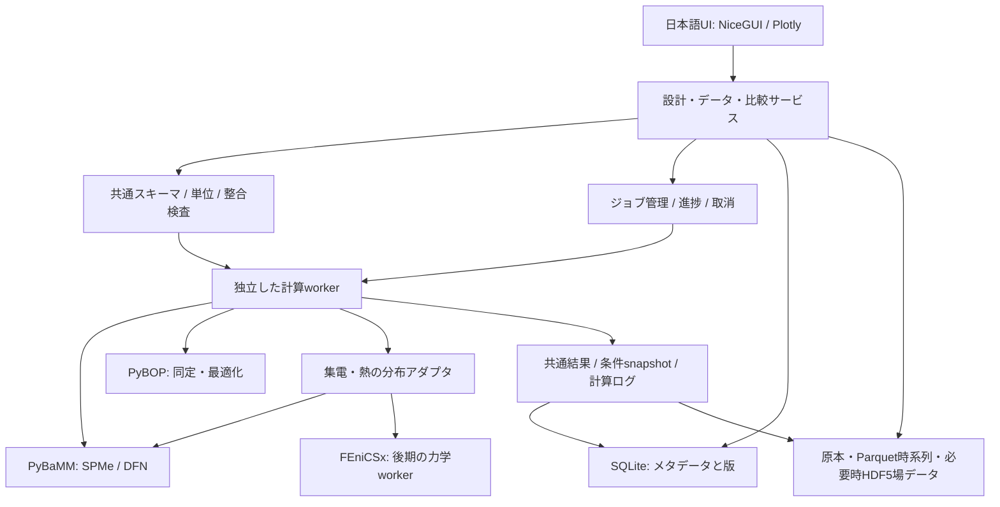

# 物理モデルとシステム設計

調査・設計日：2026-10-14。以下は実装案であり、実装済み機能ではない。OSSの確認範囲は[調査表](01_OSS調査と採用戦略.md)に記載する。

## 1. 対象と設計原則

対象は18650／21700、上下端面からの全面集電、NCX系／LFP正極、黒鉛100%／黒鉛・Si混合負極である。NCXの具体組成は未指定なので、NMC・NCAなどを材料レシピで区別する。SiとSiOxは別材料とする。手元に実測データがない初期段階では、合成カーブを使いながら、後から実測を取り込める構造を先に作る。

上下端面集電は、初期の編集可能な接続例を「上端のAl側→正極端子、下端のCu側→負極端子」とする。ユーザーの実構造に合わせて変更できるようにし、端板・缶・絶縁部品の電気的接続は明示する。正負極の箔端を同じ導体に接続する意味ではない。

設計入力は、表示用3D形状、容量・質量計算、電気化学、集電・熱、構造力学で共用する。同じ寸法が画面ごとに別々の値にならないことを最優先とする。ただし、未対応の設計入力を計算へ黙って無視せず、「形状のみ反映」「集中定数へ反映」「分布解析へ反映」を表示する。

## 2. 精度と計算負荷の階層

| 階層 | モデル | 主な用途 | このモデルだけでは判断しないこと |
|---|---|---|---|
| L0 | 設計収支・OCV曲線合成 | 寸法、容量、質量、N/Pの整合 | 負荷時の分極・局所析出 |
| L1 | ECM、SPM | UIプレビュー、既知条件内の高速探索 | 電解液枯渇、全面集電の局所偏り |
| L2 | SPMe＋集中熱 | 通常の設計探索・条件比較 | 高い不均一性がある条件の局所限界 |
| L3 | DFN＋必要な劣化・熱 | 基準カーブ、電解液、局所反応・析出評価 | セル全体の空間分布、缶応力 |
| L4 | 分布したSPMe/DFN＋集電網＋R–z熱 | 全面集電、接触抵抗、温度・反応の偏り | 周方向の離散溶接、詳細らせん形状 |
| L5 | 均質化力学FEM、必要に応じ3D | 膨張、缶との接触、応力分布 | 未測定材料の破壊・短絡を確定すること |

既定モデルはSPMe、比較基準はDFNとする。SPMやECMも残すが、入力を変更した場合に旧ECMの校正が有効とは扱わない。モデル切替は「何C以下なら必ずSPMe」と固定せず、材料・温度・厚み・電解液ごとに適用範囲を調べる。端子電圧が一致しても、最小電解液濃度や局所析出過電圧が一致するとは限らない。

DFNはNewman型の多孔質電極モデルを軸とし、電極厚み方向の電解液輸送、固相・液相の電荷保存、粒子内拡散、界面反応を解く。縮約の位置付けは[多孔質電極モデルのレビュー](https://arxiv.org/abs/2203.16091)を参照する。

座標は `x：正負極・セパレータの厚み方向`、`r_p：活物質粒子半径`、`R,z,θ：セルの半径・軸・周方向` と分ける。P2Dの擬似2次元は主にxと粒子内座標に由来し、円筒断面の2D解析ではない。

## 3. 設計データと巻回構造

### 必須入力

| 区分 | 入力と管理する意味 |
|---|---|
| 外装 | 外径、全高、缶厚、底・蓋・ガスケット、内径・有効内部高さ |
| 巻回体 | 内外半径、中心空間、巻数または長さ、圧縮状態、有効高さ |
| 電極 | 箔厚、片面塗工厚、両面/片面、塗工幅・長さ、未塗工部、正負極重なり、オーバーハング |
| セパレータ | 厚み、幅、空隙率、圧縮特性、電極端からのはみ出し |
| 配合 | 活物質・導電助剤・バインダの質量分率、各真密度、空隙率、粒径、比表面積 |
| 集電 | Cu/Al導電率、接続する箔端、端板、溶接/接触率、接触抵抗、端子抵抗 |
| 電解液 | 塩・溶媒・添加剤の識別、濃度、温度依存物性、注液量、飽和の仮定 |
| 熱・力学 | 熱物性、境界条件、初期温度、弾性・異方性、化学膨張、拘束・接触 |

18650／21700はサイズ分類であり、内部の巻回寸法を一意に決めない。外径18/21 mm、全高65/70 mmを模式図の開始値にできるが、缶・封口部・中心軸・塗工有効域は独立に設定する。

### 巻回近似と容量収支

両面塗工電極を一組含む理想繰返しでは、径方向の一巻き増分を概算で

`δ = t_Cu + t_Al + 2 L_n + 2 L_p + 2 L_s`

と置く。ここでL_n/L_pは片面塗工厚、L_sは一枚のセパレータ厚。らせんを `R(θ)=R_i+δθ/(2π)` と近似し、`N≈(R_o−R_i)/δ`、巻回長を `L_w≈π(R_o²−R_i²)/δ` と見積もる。これは端部・巻始め・圧縮・層の半径差を無視した設計チェック用近似であり、最終の層別長さ・面積は積層定義から計算する。

電極kの可逆容量の設計値は、均一塗工・共通有効面積の仮定で

`Q_k [Ah] = (F/3600) A_eff,k L_k Σ_j(ε_act,k,j c_max,k,j |Δθ_k,j|)`

と算出できる。A_effには実際に向かい合う活性面を数え、両面塗工の係数2やPyBaMM側の並列電極数を二重計上しない。局所区画化した場合も各区画の面積・容量の総和が全体と一致するようにする。

N/Pは同じ評価温度・利用化学量論範囲における負極/正極可逆容量比として定義する。フルセル容量は単なる`min(Q_n,Q_p)`だけでは確定せず、初期Li在庫、各極の初期化学量論、電圧終止条件で決まる。初回不可逆容量やプレリチエーションも将来追加できる項目にする。

厚み・面密度・空隙率・配合をすべて独立に自由設定すると矛盾する。既定では「厚み＋空隙率＋固相配合」から面密度を導出し、面密度入力モードでは厚み等の一項を導出値に切り替える。全電極の容量算定値、入力公称容量、Cレートの基準容量は別フィールドとし、差を表示する。

Si配合のwt%と活物質体積分率を区別する。固相内の体積比は`(w_j/ρ_j)/Σ(w_i/ρ_i)`で換算し、空隙率を含めて電極体積に対する分率へ変換する。活物質だけを分母にした配合か、バインダ等を含む全固相配合かも保存する。

## 4. 全面集電の扱い

「全面集電」を接触抵抗ゼロ・完全均一電流と同義にしない。箔内の電流経路、端板の抵抗、実際の接続面積、正負極別の端面接触、局所発熱が残る。円筒セルのtablessにおける電気化学・熱の分布解析は[21700の原著研究](https://www.sciencedirect.com/science/article/pii/S1359431124005477)にもある。

実装を次の三段階にする。

1. **集中モデル**：全面集電を形状・総抵抗・熱境界へ反映。局所電流分布は未計算と表示。
2. **軸対称の均質化モデル**：R–z領域に電気化学区画を配置し、Cu/Alの二つの集電経路、端板・端子を接続する。電流分配はKCLと各区画の電位差を連立して決める。
3. **周方向分割／3D**：溶接位置、接触欠損、部分的端面接続、離散した発熱源が重要になったときに追加。

端面の接触面積率、面積比抵抗`Ω m²`、実接触面積、等価抵抗`Ω`を区別する。接触率を電流経路のモデルにも抵抗換算にも重ねて入れない。共通端子に接続されても、局所SOC・温度・抵抗が違えば局所電流は同じにならない。

軸対称では周方向に均一化するため、特定の溶接点や詳細らせんのホットスポットは再現できない。この近似をUIの結果と出力レポートに残す。巻回体の電気伝導・熱伝導の異方性と、集電箔の連続性を保つ必要があり、単なる等方導電円柱には置き換えない。

[JellyBaMM](https://github.com/TomTranter/JellyBaMM)の区画・ネットワーク化、[STEER OpenCell](https://github.com/stanford-developers/steer-opencell-design)の形状階層をPoCで評価する。既存ツールのAPIを内部標準にせず、独自の設計ID・面積・接続情報を変換するアダプタに閉じ込める。

## 5. 材料別のモデル設計

| 材料 | 最初の扱い | 追加して確認する点 |
|---|---|---|
| NCX | NMC/NCA等の具体レシピとOCP・輸送物性を登録 | 組成違いを単なる容量倍率で表現しない。粒径・劣化・温度依存を分離 |
| LFP | LFPのOCP・拡散・反応速度を使用 | 平坦なOCV域でのSOC識別、充放電ヒステリシス。相分離の詳細はMPET等の後期課題 |
| 黒鉛100% | 一活物質相 | ステージングを反映するOCP、粒径、膨張関数、析出特性 |
| 黒鉛＋Si | 原則二活物質相 | 各相のOCP・拡散・反応・比表面積・膨張・Li分配を別管理 |

複合負極の公式実装例は[PyBaMM composite particle](https://docs.pybamm.org/en/pybamm-v26.9.0.0/source/examples/notebooks/models/composite_particle.html)にある。Siの履歴依存は[ヒステリシス例](https://docs.pybamm.org/en/pybamm-v26.9.0.0/source/examples/notebooks/models/hysteresis-state-models.html)を参考にするが、実材料への校正は別作業である。

Si分率0%では一相モデルへ切り替える。ゼロ体積の相に反応面積や電流を残さない。公開のChen2020系パラメータに使われるLG M50は黒鉛/SiOx系であり、純Si混合セルの実測検証と扱わない。[Chenらの原著](https://doi.org/10.1149/1945-7111/ab9050)

## 6. リチウム析出

初期はDFNで、局所負極電位、反応・膜抵抗を含む過電圧、析出/再溶解電流、可逆析出Li、dead Li、Li在庫損失を分ける。符号規約はアダプタで統一し、例えば`η_pl = φ_s − φ_e − U_Li − Δφ_film`を採用する場合には、電位の基準と膜電位降下の向きを明記する。

過電圧が析出側に入ったことは反応が起こり得る条件であり、それだけで析出量は決まらない。速度式、温度、反応面積、SEI、再溶解・不活性化の係数が必要となる。端子電圧や負極平均値だけで局所析出を判定しない。

PyBaMMには可逆・部分可逆・不可逆の例があるが、各材料・条件に適切な選択と校正が必要である。[析出例](https://docs.pybamm.org/en/pybamm-v26.9.0.0/source/examples/notebooks/models/lithium-plating.html)

UIでは「析出指標」「モデルが予測する析出量」「実測で確認された析出」を別項目にする。デンドライト形状、セパレータ貫通、内部短絡時刻は初期モデルの出力対象にしない。複合負極では相別反応面積と析出モデルの対応を確認し、単相で動作した設定をそのまま流用しない。

## 7. 電解液の影響

第1段階は、塩濃度cと温度Tに対する拡散係数`D_e(c,T)`、イオン伝導率`κ(c,T)`、輸率`t_+(c,T)`、熱力学因子、初期濃度、空隙率・輸送効率を扱う。濃度単位、適用温度範囲、使用する濃厚溶液理論・参照速度の定義も記録する。

Bruggeman則と屈曲度を同時に掛けて輸送抵抗を二重計上しない。例えば`D_eff=D_bulk ε/τ_factor`と定義した場合、そのτが経路長比なのかその二乗を含む因子なのかを明記する。CT由来の物性は[OpenPNM](https://github.com/PMEAL/OpenPNM)や[TauFactor](https://github.com/tldr-group/taufactor)を後期に利用できる。

「注液量」と「電解液濃度」は別入力である。孔隙体積、セパレータ内体積、余剰空間から概算の必要液量を計算する。完全飽和を仮定する通常のDFNでは、飽和後に余剰注液量だけ増やしてもカーブが自動的に変わるわけではない。液不足・濡れ・乾燥・ガスによる飽和率変化を扱う場合は、別の物理モデルと物性が必要になる。

第2段階で既知電解液レシピ間の比較、第3段階で多溶媒・添加剤・副反応を研究する。塩や添加剤の名称だけから全物性・SEI反応を生成しない。共溶媒の再分布にも追加モデルが必要である。[共溶媒偏析の原著研究](https://arxiv.org/abs/2311.05467)

## 8. 熱・膨張・応力

熱は集中定数→R–z異方性熱伝導の順に進める。側面・上面・下面の熱伝達と端板接触を別に入力し、反応熱・抵抗熱・可逆熱・接触ジュール熱の収支を揃える。電気化学ソルバの発熱に既に含まれる抵抗を外部網でも発熱させない。表面センサ温度と体積平均・中心温度は比較対象を分ける。

PyBaMMの集中熱を出発点にできるが、公開の空間分布熱モデルの例をそのまま円筒R–zの全面集電解析とみなさない。[熱モデル例](https://docs.pybamm.org/en/pybamm-v26.9.0.0/source/examples/notebooks/models/thermal-models.html)

力学は次の階層を分離する。

1. **粒子内**：濃度勾配と化学膨張による粒子応力。粒子割れ・活物質損失は追加モデル。
2. **塗工層・巻回体**：各相のSOC・温度から有効化学ひずみを計算。異方性、孔隙、バインダ、セパレータの圧縮性を反映。
3. **缶・接触**：巻回体と缶の初期隙間、端部拘束、接触、必要に応じ摩擦・塑性を解く。
4. **双方向連成**：変形から空隙率・輸送・接触抵抗を更新。収束条件と物理式を検証してから有効化。

第1段階の粒子力学には[PyBaMMの連成劣化例](https://docs.pybamm.org/en/pybamm-v26.9.0.0/source/examples/notebooks/models/coupled-degradation.html)がある。第2・3段階は[FEniCSx](https://github.com/FEniCS/dolfinx/blob/main/README.md)等で独自に組み立てる。活物質の自由膨張率をそのまま缶の径変化に掛けない。缶応力は巻回体の圧縮性や接触条件に大きく依存する。

初めは電気化学→化学ひずみ→力学の一方向連成とし、反応に応力が戻る機能は無効と明示する。薄肉円筒式`σ_θ≈pR/t`は均一圧力・薄肉という条件での検算に限定する。ガス圧は固体膨張による接触圧と分け、生成モデルがない段階では別入力とする。

## 9. システム構成案

初期UIは[NiceGUI](https://github.com/zauberzeug/nicegui)＋Plotlyを提案する。表編集・取込・比較・ジョブ一覧をPythonで組める点を重視する。研究用notebookも同じサービスAPIから実行できるようにする。大規模な多人利用が必要になればReact等への置換を検討するが、UIに物理式やファイル処理を埋め込まない。

ローカル版はSQLiteと独立プロセスのジョブキューで開始する。CPU計算をUIのイベントループ内で実行しない。重い計算の別worker化という方針は[FastAPIの説明](https://fastapi.tiangolo.com/tutorial/background-tasks/)とも整合する。Redis等は複数worker・サーバー運用が必要になってから追加する。

内部の正本は独自スキーマとし、BPXは電気化学パラメータの交換アダプタとして用いる。BPXだけに端面接触、缶力学、実験来歴を押し込めない。数値は内部SIに揃え、UIではμm、mm、mAh等に換算して表示する。材料関数には式/テーブル、単位、補間法、定義域、出典、温度依存を付ける。

実行ごとに入力snapshot、ソルバ版、モデルオプション、メッシュ、許容誤差、初期化手順、乱数seedを保存する。キャッシュのキーはこれらを含める。失敗・取消・終止条件での正常終了を区別し、途中結果には最後の有効時刻と状態を表示する。異常終了を容量不足の設計結果として扱わない。

FEniCSxはWindows nativeの制約もあるため、初期のPyBaMM/UIはWindows、力学はWSL2/Linux workerという分離を比較する。現在のPython 3.14環境は変更せず、Step 0で別のPython 3.12環境を候補に依存解決を確認する。

## 10. UIの操作順序

1. **プロジェクト**：設計、実験データ、過去計算、比較セットを選択。
2. **セル設計**：18650/21700、巻回断面、上下端面接続、寸法・面積・容量収支。
3. **材料と電解液**：材料レシピ、配合、出典、欠けているパラメータ。
4. **試験条件**：初期状態、温度、CC/CV、休止、電流プロファイル、繰返し、終止条件。
5. **モデルと計算**：精度、使用機能、近似、計算時間の実測履歴、実行・取消。
6. **結果と比較**：電圧、容量、温度、電解液、析出、膨張・応力を適用可能範囲で表示。
7. **データライブラリ**：取り込み、検索、注釈、比較、同定用データの指定。

基本入力を常時表示し、粒径分布・反応定数・接触則などは詳細設定に置く。未対応のモデル組合せは選択不可にし、理由を近くに表示する。未計算の応力を0 MPaで表示しない。模式的な巻回3Dと、計算された温度/応力場の色表示は明確に区別する。

最初の画面で「入力→計算→保存→比較」が一巡することを優先し、3D外観の精密化はその後にする。
